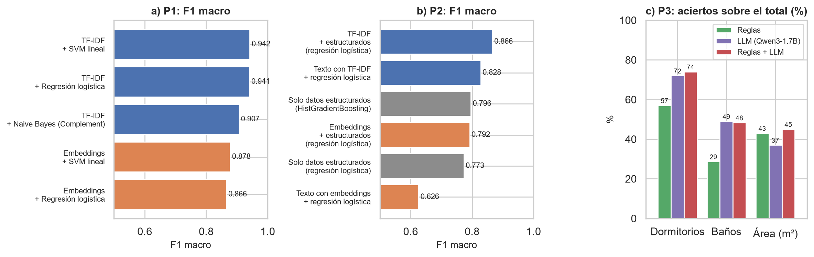

# CC219-TP-TF-2026-2-CC92

## Minería de textos en avisos inmobiliarios del Perú

Trabajo Parcial y Trabajo Final del curso CC219 Aplicaciones de Data Science (UPC, sección CC92, ciclo 2026-2).

## Objetivo del trabajo

Aplicar minería de textos y procesamiento de lenguaje natural (NLP) a avisos inmobiliarios reales del Perú para clasificar el tipo de inmueble, predecir el segmento de precio y predecir el número de dormitorios, el número de baños y el área que faltan en los campos estructurados.

| Pregunta | Tipo | Descripción |
|---|---|---|
| P1 | Clasificación | ¿Se puede identificar el tipo de inmueble (departamento, casa, lote, local comercial u oficina) solo con el título y la descripción, y reclasificar los avisos registrados como "Otro"? |
| P2 | Predicción | ¿Se puede predecir el segmento de precio (económico, medio o alto) de un departamento en venta en Lima Metropolitana usando el texto del aviso? ¿Qué términos pesan más? |
| P3 | Predicción | ¿Se pueden predecir los dormitorios, los baños y el área del inmueble a partir del texto? ¿Un LLM lo hace mejor que las reglas? |

En el Trabajo Parcial también se planteó un buscador semántico. Para el Trabajo Final se dejaron las tres preguntas de clasificación y predicción que pide el enunciado y el buscador quedó como trabajo futuro, por eso la antigua P4 ahora es la P3.

## Integrantes

| Apellidos y nombres | Código |
|---|---|
| Enriquez Montalvan, Renee | U202221447 |
| Granados Allende, Juan Felipe | U202212216 |
| Ramos Parihuaman, David Miguel | U202417368 |

## Dataset

- Nombre: *Property Listings for 5 South American Countries* (Jacobsen, 2020), publicado en Kaggle: https://www.kaggle.com/datasets/rmjacobsen/property-listings-for-5-south-american-countries
- Origen: avisos publicados en el portal Properati y liberados por Properati Data. Se usa solo el archivo del Perú (pe_properties.csv).
- Tamaño: 124,449 avisos y 25 variables, publicados entre el 1 de marzo de 2019 y el 24 de marzo de 2020.
- Tipo de datos: semiestructurados. Campos estructurados (tipo de inmueble, operación, precio, moneda, área, dormitorios, baños y ubicación) y texto libre en español (título y descripción del aviso).
- La descripción completa del dataset y del análisis está en el informe: docs/TF_Informe_Enriquez_Granados_Ramos.pdf

| Archivo de la carpeta data | Descripción |
|---|---|
| pe_properties.csv.xz | Dataset original del Perú, sin cambios (comprimido en xz; pandas lo lee directamente). |
| avisos_pe_limpio.csv.xz | Dataset final: 103,423 avisos y 41 variables, sin duplicados, con textos anonimizados (sin teléfonos, correos ni enlaces), montos enmascarados, texto normalizado, variables derivadas (dormitorios, baños y áreas extraídos del texto, amenidades y segmento de precio) y el tipo predicho para los avisos "Otro". |
| p3_muestra_reglas_llm.csv | Muestra de 300 avisos de la P3 con los valores de los campos y las respuestas de las reglas, del LLM y de la combinación. |

## Estructura del repositorio

- README.md, LICENSE y requirements.txt
- data/: dataset original, dataset final y muestra de la P3
- code/
  - TF_Avisos_Inmobiliarios_PE.ipynb: cuaderno del Trabajo Final (carga, EDA, modelos y resultados)
  - TP_EDA_Avisos_Inmobiliarios_PE.ipynb: cuaderno del Trabajo Parcial
- figs/: figuras del informe final (fig1 a fig10, con la misma numeración del informe) y la figura de resumen de resultados (fig11)
- docs/: informe final en PDF

## Cómo ejecutar

1. Abrir code/TF_Avisos_Inmobiliarios_PE.ipynb en Google Colab (Archivo > Abrir cuaderno > GitHub) y activar la GPU (Entorno de ejecución > Cambiar tipo de entorno > T4), porque la sección 5 usa embeddings y un LLM.
2. Ejecutar todas las celdas. El cuaderno descarga el dataset de Kaggle con kagglehub (no pide credenciales). Si se trabaja con el repositorio clonado, lee data/pe_properties.csv.xz.
3. En local: pip install -r requirements.txt y abrir el cuaderno con Jupyter.

## Resultados

P1, conjunto de prueba (16,351 avisos):

| Representación | Modelo | Accuracy | F1 macro |
|---|---|---|---|
| TF-IDF | Naive Bayes (Complement) | 0.938 | 0.907 |
| TF-IDF | Regresión logística | 0.961 | 0.941 |
| TF-IDF | SVM lineal | 0.962 | 0.942 |
| Sentence embeddings | Regresión logística | 0.905 | 0.866 |
| Sentence embeddings | SVM lineal | 0.916 | 0.878 |

Con el SVM lineal y una opción "Ninguno" para los avisos poco seguros, 17,752 de los 21,077 avisos "Otro" se reclasifican en una de las cinco clases.

P2, conjunto de prueba (4,502 departamentos):

| Fuente | Modelo | Accuracy | F1 macro |
|---|---|---|---|
| Solo estructuradas | HistGradientBoosting | 0.796 | 0.796 |
| Solo estructuradas | Regresión logística | 0.774 | 0.773 |
| Solo texto | TF-IDF + regresión logística | 0.829 | 0.828 |
| Solo texto | Embeddings + regresión logística | 0.631 | 0.626 |
| Texto + estructuradas | TF-IDF + regresión logística | 0.867 | 0.866 |
| Texto + estructuradas | Embeddings + regresión logística | 0.793 | 0.792 |

P3, muestra de 300 avisos (aciertos sobre el total, en %):

| Método | Dormitorios | Baños | Área |
|---|---|---|---|
| Reglas | 57.0 | 28.7 | 43.0 |
| LLM (Qwen3-1.7B) | 72.0 | 49.0 | 37.0 |
| Reglas + LLM | 74.0 | 48.3 | 45.0 |

## Conclusiones

- El texto es la fuente más completa del dataset: está en casi todos los avisos, mientras que dormitorios (66.7%), área techada (59.4%) o baños (29.7%) faltan con frecuencia en los campos estructurados.
- P1: TF-IDF con un SVM lineal identifica el tipo de inmueble con F1 macro de 0.942. La opción "Ninguno" deja fuera la mayoría de los avisos "Otro" que no son de las cinco clases (habitaciones, edificios, almacenes).
- P2: el texto solo predice el segmento de precio con F1 macro de 0.828 y junto con los datos estructurados llega a 0.866. Los coeficientes muestran que pesan el distrito, la cochera, la terraza y el área.
- En la P1 y la P2 los sentence embeddings quedaron por debajo de TF-IDF.
- P3: el LLM devolvió un JSON válido en todos los avisos y, junto con las reglas, subió los aciertos de dormitorios de 57.0% a 74.0%. En baños el resultado es bajo (49.0%) y parece que el campo de Properati no cuenta igual los baños de servicio o de visita.
- Trabajo futuro: etiquetar a mano una muestra para evaluar mejor la P3, probar modelos que lean textos más largos o con ajuste fino, y construir el buscador semántico planteado en el Trabajo Parcial.

## Licencia

- Código: licencia MIT (ver LICENSE).
- Datos: provienen de Properati Data a través de Kaggle (Jacobsen, 2020), que permite su uso citando a Properati como fuente. El dataset limpio se comparte con la misma condición.
- Modelos usados: paraphrase-multilingual-MiniLM-L12-v2 (Apache 2.0) y Qwen3-1.7B (Apache 2.0), descargados de Hugging Face al ejecutar el cuaderno.

## Referencia del dataset

Jacobsen, R. (2020). *Property listings for 5 South American countries* [Conjunto de datos]. Kaggle. https://www.kaggle.com/datasets/rmjacobsen/property-listings-for-5-south-american-countries
